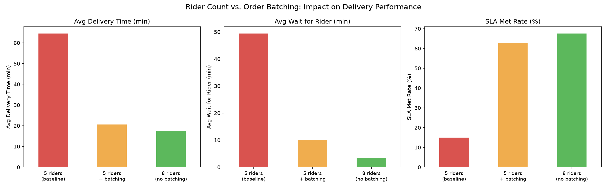

# Dark Store Dispatch Simulation

A discrete-event simulation exploring a common operational trade-off in quick-commerce delivery: **should you add more riders, or make dispatch smarter through order batching?**

Built to practice thinking about operational levers the way a program/ops manager would — not just measuring an outcome, but comparing the cost and impact of different interventions.

## The question

A dark store gets a steady stream of incoming orders throughout the day. When demand outpaces rider capacity, delivery times and SLA compliance suffer. There are (at least) two ways to fix this:
1. **Hire more riders** — straightforward, but adds ongoing headcount cost.
2. **Batch orders** — let a rider carry two orders per trip if they're queued close together, improving throughput without adding riders.

This project simulates both and compares the results.

## How it works

Built with [SimPy](https://simpy.readthedocs.io/), a discrete-event simulation library. Orders arrive randomly throughout an 8-hour shift. Riders are modeled as a limited resource; each pickup takes a fixed packing time plus a randomized delivery time. In the batching variant, a rider who's just picked up an order waits a short window (1.5 min) to see if a second order arrives before heading out, adding one extra stop instead of a full second trip.

Three scenarios were run:
- **5 riders (baseline)** — no batching
- **5 riders + batching** — same rider count, batching enabled
- **8 riders (no batching)** — more riders, no batching

Each scenario measures: average delivery time, average wait time for a rider, and % of orders meeting a 20-minute SLA.

## Results

| Scenario | Avg Delivery Time | Avg Wait for Rider | SLA Met Rate |
|---|---|---|---|
| 5 riders (baseline) | 64.5 min | 49.4 min | 14.9% |
| 5 riders + batching | 20.6 min | 10.0 min | 62.7% |
| 8 riders (no batching) | 17.6 min | 3.5 min | 67.6% |



## What this shows

Batching at the **same rider count** captured most of the benefit of a 60% increase in headcount (5 → 8 riders) — SLA compliance went from 14.9% to 62.7% with batching alone, compared to 67.6% by adding 3 more riders. This suggests that, at least in this simplified model, smarter dispatch logic can be a meaningfully cheaper lever than hiring, before headcount is even considered.

## Tech stack

- Python
- [SimPy](https://simpy.readthedocs.io/) — discrete-event simulation
- Pandas — data handling
- Matplotlib — visualization

## How to run it

```bash
pip install -r requirements.txt
python src/simulation.py              # baseline: 5 riders, no batching
python src/simulation_batching.py     # batching variant (toggle ENABLE_BATCHING in the file)
python src/plot_comparison.py         # generates comparison charts
```

Change `NUM_RIDERS` in `simulation.py` to test different rider counts.

## Limitations & future work

This is a simplified model built for learning purposes, not a proposal for how a real quick-commerce dispatch system should work — real systems account for live geolocation, traffic conditions, order value prioritization, and far more complex batching logic than modeled here. Possible extensions: variable order arrival rates across the day (peak vs. off-peak), rider-specific delivery speeds, and combined batching + rider count optimization to find a cost-efficient frontier.